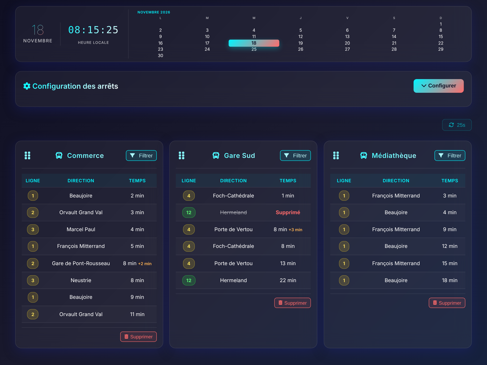

# Mes arrêts — Nantes

Tableau de bord **temps réel** des prochains passages aux arrêts du réseau de transport en commun de Nantes (TAN / Naolib). On choisit ses arrêts, et la page affiche en continu les prochains passages, sans compte ni installation.

*Imaginé à Nantes par DrixLab - Développé par Claude dans les nuages*

> Projet indépendant, **non affilié** à Naolib, à la TAN ni à Nantes Métropole. Les noms de réseau et d'arrêts appartiennent à leurs propriétaires respectifs.

*Aperçu de l'application. Les horaires affichés sont des données d'exemple.*

## Fonctionnalités

- Choix libre des arrêts, avec les lignes qui desservent chacun, et recherche par nom (insensible aux accents) **ou par ligne** : « C2 » liste les arrêts de la ligne C2, « ligne 2 c2 » ceux où l'on passe de l'une à l'autre. Le numéro du lieu s'affiche pour les arrêts homonymes (« Jean Jaurès »). Réorganisation des cartes par glisser-déposer (souris, tactile ou flèches du clavier).
- Prochains passages en minutes, mis à jour chaque seconde ; retards et suppressions signalés.
- Pastilles de ligne aux **couleurs officielles Naolib**, dans le tableau, les filtres et la liste d'arrêts (le nom complet de la ligne s'affiche au survol).
- Filtres par ligne et par destination pour chaque arrêt.
- Actualisation automatique toutes les 30 secondes, avec nouvel essai si le réseau est coupé ; aucune requête tant que l'onglet est masqué.
- Horloge et calendrier ; interface en français, adaptée au mobile.
- Aucun serveur, aucun build : tout tourne dans le navigateur.

## Utilisation

**En ligne** : <https://drixlab.github.io/MES_ARRETS_NANTES/> (GitHub Pages).

En local : télécharger le dépôt et ouvrir `MES_ARRETS_NANTES.html` dans un navigateur (`stops.js`, `lines.js`, `icons/` et `vendor/` doivent rester dans le même dossier). Cliquer sur « Configurer » pour ajouter des arrêts. Les données temps réel demandent un accès internet.

## Données et crédits

- **Arrêts, lignes de chaque arrêt, noms et couleurs des lignes** : extraits du GTFS « Réseau urbain Naolib » (Nantes Métropole), diffusé sur [transport.data.gouv.fr](https://transport.data.gouv.fr/datasets/reseau-de-transports-collectifs-naolib), dans `stops.js` et `lines.js`. Source : Nantes Métropole, *Réseau urbain Naolib* — GTFS ; données du 18 novembre 2026. Ces données sont publiées sous [Licence Ouverte 2.0](https://www.etalab.gouv.fr/licence-ouverte-open-licence/).
- **Passages en temps réel** : API SIRI (StopMonitoring) exposée par la passerelle Okina pour le réseau Naolib.
- **Police** [Inter](https://rsms.me/inter/) (licence SIL OFL 1.1) et **icônes** [Font Awesome Free](https://fontawesome.com/) 6 (icônes CC BY 4.0, polices SIL OFL 1.1, code MIT), hébergées dans `vendor/` avec leurs licences.

L'API impose **une requête toutes les 30 secondes** : si vous modifiez ou déployez ce projet, conservez cette limite et n'ajoutez pas de requêtes supplémentaires.

## Confidentialité

L'application n'a ni serveur, ni compte, ni cookie, ni outil de mesure d'audience.

- Vos arrêts, vos filtres et les derniers passages reçus sont conservés **uniquement dans le `localStorage` de votre navigateur**, et le bouton « Effacer toutes les données sauvegardées » les supprime.
- Pour fonctionner, la page contacte **uniquement** `api.okina.fr` (avec les identifiants des quais des arrêts choisis), qui voit l'adresse IP du visiteur. Les polices et les icônes sont servies par le site lui-même : aucun CDN ni service tiers n'est appelé.

## Licence

- **Code de l'application** : [GNU GPL v3](LICENSE). Vous pouvez l'utiliser, l'étudier, le modifier et le redistribuer, à condition de conserver la même licence pour les versions modifiées que vous distribuez.
- **Données des arrêts (`stops.js`) et des lignes (`lines.js`)** : [Licence Ouverte 2.0](https://www.etalab.gouv.fr/licence-ouverte-open-licence/) (Etalab). Pour les réutiliser, il faut mentionner la source (Nantes Métropole, *Réseau urbain Naolib*) et la date de mise à jour des données.
- **Ressources tierces (`vendor/`)** : police Inter et Font Awesome Free, chacune sous sa propre licence (textes fournis dans `vendor/`).

## Documentation technique

### Fichiers

- `MES_ARRETS_NANTES.html` — l'application : CSS dans `<style>`, balisage, puis un `<script>` inline avec toute la logique.
- `index.html` — simple redirection vers `MES_ARRETS_NANTES.html`, pour que GitHub Pages serve l'application à la racine du site ; `.nojekyll` désactive le traitement Jekyll de Pages.
- `stops.js` — données embarquées des arrêts (`STOP_LIST`, **généré** par `tools/generate_stops.py`), chargées par une balise `<script src="stops.js">` **avant** le script principal. Il doit rester dans le même dossier que le HTML.
- `vendor/` — police Inter (variable, sous-ensemble latin) et Font Awesome Free 6 (style solid uniquement), copiés depuis leurs paquets npm officiels avec leurs licences ; versions et procédure de mise à jour dans `vendor/README.md`.
- `docs/apercu.png` — capture d'écran du README (données d'exemple, non issues de l'API) ; à régénérer si l'interface change nettement.
- `lines.js` — lignes du réseau (couleur officielle, nom, ordre) et lignes qui desservent chaque arrêt (`LINE_INFO`, `STOP_LINES`), chargé juste après `stops.js`. **Fichier généré** : ne pas le modifier à la main. La page fonctionne aussi sans lui (couleurs calculées, pas de lignes dans la liste).
- `tools/` — scripts de mise à jour des données, à lancer dans cet ordre avec le GTFS Naolib téléchargé sur la page du jeu de données ci-dessus (bibliothèque standard Python seulement) :
  1. `python3 tools/generate_stops.py gtfs.zip stops.js` met à jour `stops.js` ; il **fusionne** le GTFS avec la liste existante sans rien retirer (les numéros de quai changent d'une version à l'autre et l'API temps réel n'est pas interrogeable hors du navigateur) ;
  2. `python3 tools/generate_lines.py gtfs.zip stops.js lines.js` régénère `lines.js`.
- `icons/` — `favicon.svg` est la source de l'icône de l'onglet (un bus vu de face avec des ondes « temps réel », aux couleurs de l'appli) ; `apple-touch-icon.png` (180 px, sans coins arrondis) est le seul fichier référencé par la page. L'icône d'onglet elle-même est **embarquée dans le `<head>`** en data URI (SVG + PNG 32 px de repli), donc la page l'affiche même copiée seule. Pour la modifier : éditer `icons/favicon.svg`, puis réencoder les deux data URI du `<head>` (SVG minifié et percent-encodé, PNG 32 px en base64) et régénérer `apple-touch-icon.png`.

Pas de build, pas de gestionnaire de paquets, pas de tests, pas de linter. Côté CSS : le dégradé de texte de l'en-tête de carte ne s'applique qu'au titre (`.widget-header .title`), car `-webkit-text-fill-color: transparent` est hérité et rendait invisible le libellé du bouton « Filtrer » ouvert ; pas de `backdrop-filter` (coût GPU sans effet visible sur ce fond) ; `prefers-reduced-motion` est respecté. Les textes de l'interface, les commentaires et les messages de commit sont en français ; garder cette convention. Les données live demandent l'accès réseau à `api.okina.fr` et une réponse CORS autorisée par le navigateur ; aucune ressource n'est chargée depuis un CDN. Pour vérifier un changement, charger la page (Playwright/Chromium convient pour des vérifications scriptées, en simulant l'API avec `page.route`).

### Source de données : SIRI (Okina)

Les passages viennent d'un endpoint **SIRI StopMonitoring** (`CONFIG.SIRI_ENDPOINT`, `https://api.okina.fr/gateway/sem/realtime/anshar/services`) par **un seul POST XML** contenant une `StopMonitoringRequest` par quai (`MonitoringRef` = `FR_NAOLIB:Quay:<id>`). La réponse est lue avec `DOMParser` + `getElementsByTagNameNS` dans `TransportManager.parseSiriResponse()`. L'ancienne API `open.tan.fr/ewp` (`arrets.json`, `tempsattente.json`) n'est plus utilisée.

- **Limite : 1 requête / 30 s pour tous les arrêts réunis** (`CONFIG.FETCH_COOLDOWN_S`). Garde dans `loadAllStopsData` via `lastFetchTime` ; sur HTTP 429 on garde le cache. Ne jamais ajouter de requête par arrêt ni de second timer de polling.
- **Les arrêts sont embarqués, pas téléchargés.** `STOP_LIST` (`stops.js`) vaut `[nom, placeId, [quayIds]]`. Au démarrage, il produit `STOP_MAP` (placeId → {name, quays}) et `QUAY_TO_PLACE` (quayId → placeId). Le « code d'arrêt » utilisé partout (`AppState.selectedStops`, `data-stop-code`, ids DOM `content-<code>` / `filter-<code>`) est le **placeId sous forme de chaîne** ; un lieu regroupe plusieurs quais, et les réponses sont regroupées par lieu dans `loadAllStopsData`.
- Forme normalisée d'un passage : `{ quayId, stopPlaceId, line, destination, vehicleMode, expectedTime, aimedTime, status, cancelled }`. `status` vient de `DepartureStatus` (sinon `ArrivalStatus`) ; `cancelled` est vrai si le statut contient « cancel ». Les helpers `getLigne` / `getTerminus` renvoient les sentinelles `'N/A'` / `'Direction inconnue'`, que la logique de filtres teste.

### Architecture (script inline)

| Nom | Rôle |
|---|---|
| `STOP_MAP` / `QUAY_TO_PLACE` | Tables de lookup construites depuis `STOP_LIST` |
| `CONFIG` | Endpoint SIRI, intervalles, délai entre requêtes (30 s), nombre de lignes (10), seuil d'affichage du retard, `OFFICIAL_LINE_COLORS`, locale/fuseau, `STORAGE_KEY` (`nantes-dashboard-config-v2`) |
| `AppState` | État mutable unique : `availableStops`, `selectedStops`, `isConfigOpen`, `searchQuery`, `filters` |
| `StorageManager` | `save/load/clear` sur `localStorage` ; `attach(transportManager)` lui donne accès au cache à sauvegarder |
| `Utils` | Formats date/heure (fr-FR, Europe/Paris), `escapeHtml` (sûr aussi dans les attributs), `fetchText` (délai couvrant aussi la lecture du corps), `compareNatural` / `compareLines` (ordre du réseau), `lineColors` / `lineBadge` (pastilles de ligne) |
| `TimeManager` | Horloge (1 s) ; date et calendrier reconstruits seulement au changement de jour |
| `StopManager` | Sélecteur d'arrêts avec recherche et panneau de configuration |
| `TransportManager` | Cartes d'arrêt, requête/lecture SIRI, filtres, glisser-déposer, décompte, rafraîchissement de l'affichage |
| `DashboardApp` | Orchestre au `DOMContentLoaded` ; expose `window.transportManager` / `window.stopManager` pour le débogage console uniquement |

Points qui traversent plusieurs classes :

- **Ordre d'initialisation** (`DashboardApp.init`) : `StorageManager.load()` → `TimeManager` → `TransportManager(saved)` → `StorageManager.attach()` → `StopManager(transportManager)` → `transportManager.onSelectionChange` (rappel qui rafraîchit le sélecteur quand un widget retire un arrêt) → `transportManager.start()`. Les classes ne passent pas par `window.*`.
- **Le décompte pilote les requêtes.** `startCountdown()` relit `secondsUntilNextFetch()` chaque seconde et appelle `loadAllStopsData()` à 0 ; `loadAllStopsData()` relance `startCountdown()` à la fin (succès, 429 ou erreur). Pas de timer par arrêt.
- **Erreur réseau / HTTP / XML illisible** : `lastFailed = true`, `lastFetchTime = maintenant`, nouvel essai automatique 30 s plus tard (libellé « Réessai dans Ns »). Le bouton d'actualisation n'est activé (`disabled` levé, classe `.ready`) que 5 s après une erreur (`CONFIG.MIN_MANUAL_RETRY_MS`) et permet alors de forcer l'essai (`forceRefresh` → `loadAllStopsData(true)`) : pas de rafale vers l'API.
- **Onglet masqué** : le décompte n'envoie pas de requête et `refreshDisplays` ne redessine rien ; au retour (`visibilitychange`), l'affichage est rafraîchi et la requête part si le délai est écoulé.
- **Requête et sélection** : `loadAllStopsData` ne met à jour que les arrêts de la liste `requested` (instantané pris à l'envoi) ; un arrêt ajouté pendant la requête attend le cycle suivant au lieu d'afficher à tort « Aucun passage prévu ». `lastFetchTime` lu dans le stockage est ignoré s'il est illisible ou dans le futur.
- **L'affichage est redessiné chaque seconde depuis le cache** (`refreshDisplays`, via `displayInterval`) sans nouvelle requête : minutes restantes à jour, passages écoulés écartés avant la limite de 10 lignes. `setContent()` n'écrit dans le DOM que si le HTML a changé ; passer par lui pour tout contenu de `#content-<code>`. Un arrêt sans cache affiche un message d'attente avec le temps avant la prochaine requête.
- **Cache persisté** : `save()` écrit `selectedStops`, `filters`, `lastFetchTime` et le cache des **seuls arrêts sélectionnés** ; `forgetStop()` purge filtres et cache d'un arrêt retiré. À la lecture, les codes inconnus de `STOP_MAP` sont ignorés (le stockage navigateur n'est pas fiable).
- **Rendu en chaînes `innerHTML`.** `updateTransportWidgets()` reconstruit toutes les cartes quand la liste change ; seules les nouvelles cartes portent la classe `.is-new` (animation d'apparition) et le panneau de filtres ouvert (`openFilterStop`) est rouvert après le rendu. Toujours passer le texte dynamique par `Utils.escapeHtml`. Les étiquettes de filtre (`.filter-tags`) et la liste d'arrêts (`#stopList`) sont gérées par délégation d'événements.
- **Date et heure de Paris.** L'horloge, la date et le calendrier utilisent le fuseau `CONFIG.TIMEZONE` via des `Intl.DateTimeFormat` créés une fois (`Utils.parisDate`) ; le calendrier est calculé en UTC pour ne pas dépendre du fuseau de l'appareil.
- **Arrêts homonymes.** `stopInfo(code)` indique si plusieurs lieux portent le même nom (19 cas dans `stops.js`) ; le numéro du lieu est alors affiché dans la liste et sur la carte. La recherche compare des noms normalisés (`Utils.normalize` : sans accents ni ponctuation).

### État et persistance

Toute modification de `AppState.selectedStops` ou `AppState.filters` doit être suivie de `StorageManager.save()`. `AppState.filters` est indexé par code d'arrêt : `{ hiddenLines: [], hiddenDestinations: [] }`. Les destinations d'une ligne masquée sont **masquées automatiquement** (grisées avec une icône de lien, non cliquables, absentes de `hiddenDestinations`). Ce calcul est centralisé dans `getFilterContext()`, utilisé par `updateFilterOptions()` (étiquettes) et `displayStopData()` (lignes du tableau). Les lignes/destinations masquées restent listées dans le panneau même sans passage actuel, pour pouvoir les réafficher. **Couleurs des lignes** : `Utils.lineColors(code)` lit `LINE_INFO` (`lines.js`) et renvoie la couleur officielle Naolib et la couleur du texte ; `Utils.lineBadge(code, classe)` produit la pastille HTML, utilisée partout (tableau, filtres, liste d'arrêts). Les couleurs officielles sont partagées par groupes de lignes (96 lignes, 28 couleurs) : `CONFIG.OFFICIAL_LINE_COLORS = false` donne à la place une couleur distincte par ligne, calculée (teintes espacées de l'angle d'or). Une ligne absente de `lines.js` reçoit une teinte déduite de son code.

**Lignes par arrêt et recherche.** `StopManager` joint `STOP_LINES` (`lines.js`) aux arrêts de `stops.js` par l'identifiant du lieu. `parseQuery` / `filterStops` : un texte correspond à un nom d'arrêt (sans accents) **ou** à un code de ligne exact ; `ligne 2 c2` ne garde que les arrêts desservis par toutes les lignes citées. `lines.js` est généré depuis le GTFS en rattachant chaque quai à son lieu parent (les numéros de quai changent d'une version à l'autre, pas les lieux).

Si la forme des données sauvegardées change, incrémenter `CONFIG.STORAGE_KEY` (actuellement `-v2`) plutôt que de relire d'anciennes données.

### Glisser-déposer

`TransportManager.setupDragAndDrop()` ne déclenche le déplacement que depuis la poignée `.drag-handle` (un `mousedown` hors de la poignée met `draggable="false"` sur la carte), pour ne pas gêner les filtres et le bouton de suppression. La souris utilise l'API HTML5 de glisser-déposer ; le tactile utilise `touchstart/move/end` sur la poignée avec `elementFromPoint` (la poignée a `touch-action: none` pour éviter le défilement ; `touchcancel` rend la carte à son état normal). Au clavier, les flèches sur la poignée appellent `moveStop()`. Tout aboutit à `AppState.selectedStops` réordonné puis sauvegardé.
